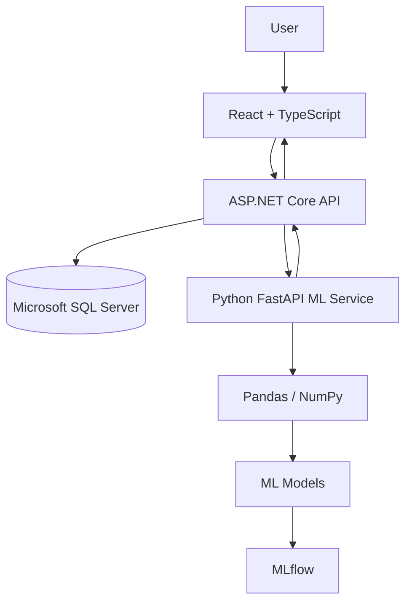

# Predictive Maintenance Platform

An intelligent industrial predictive maintenance platform designed to monitor equipment, detect anomalies, predict potential failures, and estimate the Remaining Useful Life (RUL) of industrial machines using Machine Learning.

The project combines **ASP.NET Core, C#, Python, Machine Learning, React, TypeScript, and Microsoft SQL Server** to build a realistic, scalable, and maintainable solution.

## Overview

Unexpected equipment failures can lead to production downtime, increased maintenance costs, and reduced operational efficiency.

The Predictive Maintenance Platform aims to address these challenges by analyzing machine sensor data and applying Machine Learning models to identify abnormal behavior and anticipate potential failures.

The platform will provide a centralized environment where users can:

- Manage industrial machines and their sensors.
- Collect and visualize sensor readings.
- Monitor machine operating conditions.
- Detect anomalous machine behavior.
- Predict potential equipment failures.
- Estimate the Remaining Useful Life (RUL) of machines.
- Manage maintenance activities and historical records.
- Monitor Machine Learning model performance and versions.

## Key Features

### Equipment Management

- Create and manage industrial machines.
- Store machine information, manufacturer, model, and installation date.
- Manage sensors associated with each machine.
- Monitor machine operational status.

### Sensor Data Monitoring

- Store historical sensor readings.
- Monitor parameters such as:
  - Temperature
  - Vibration
  - Pressure
  - Rotational speed
  - Operating hours
- Visualize sensor trends over time.

### Predictive Analytics

The platform will implement three main Machine Learning capabilities.

#### 1. Failure Prediction

Classification models will estimate whether a machine is likely to experience a failure.

Candidate algorithms:

- Logistic Regression
- Decision Tree
- Random Forest
- XGBoost Classifier

#### 2. Remaining Useful Life (RUL) Estimation

Regression models will estimate how much useful operating time remains before a machine is expected to fail.

Candidate algorithms:

- Linear Regression
- Decision Tree Regressor
- Random Forest Regressor
- XGBoost Regressor
- Neural Networks (advanced stage)

#### 3. Anomaly Detection

Unsupervised Machine Learning models will identify unusual patterns in sensor readings.

Candidate algorithms:

- Isolation Forest
- Additional anomaly detection approaches in future iterations

An anomaly indicates unusual behavior and does not automatically mean that a machine is going to fail.

### Maintenance Management

- Schedule maintenance activities.
- Record completed maintenance operations.
- Track maintenance history.
- Associate maintenance activities with specific machines.

### Machine Learning Model Management

- Track model versions.
- Store model evaluation metrics.
- Monitor training experiments.
- Maintain reproducibility of experiments.

## Technology Stack

| Area | Technology |
|---|---|
| Backend | C# / ASP.NET Core |
| Backend Architecture | Layered architecture |
| ORM | Entity Framework Core |
| Database | Microsoft SQL Server |
| Machine Learning API | Python / FastAPI |
| Data Processing | Pandas / NumPy |
| Machine Learning | Scikit-learn |
| Gradient Boosting | XGBoost |
| Deep Learning | PyTorch |
| Experiment Tracking | MLflow |
| Frontend | React / TypeScript |
| Frontend Build Tool | Vite |
| Styling | Tailwind CSS |
| Frontend Testing | Vitest |
| Backend Testing | xUnit |
| Containers | Docker / Docker Compose |

> Technology versions will be pinned and documented as the implementation is initialized. Prefer supported LTS releases and compatible dependency versions.

## Architecture

The platform follows a hybrid architecture, separating application business logic from Machine Learning responsibilities.



### Backend — ASP.NET Core

The .NET backend is responsible for:

- Application business logic.
- Machine and sensor management.
- Telemetry ingestion and retrieval.
- Maintenance management.
- Data persistence through Entity Framework Core.
- Communication with the Python ML service.
- API validation and security.

### Machine Learning Service — Python

The Python service is responsible for:

- Data preprocessing.
- Feature engineering.
- Machine Learning model training.
- Model evaluation.
- Failure prediction.
- Remaining Useful Life estimation.
- Anomaly detection.
- Model inference.

The ML service communicates with the .NET backend through internal HTTP APIs.

In the initial architecture, database access is centralized in the .NET backend. The Python service does not connect directly to SQL Server.

### Frontend — React

The frontend provides the user interface for:

- Equipment monitoring.
- Sensor data visualization.
- Predictive analytics dashboards.
- Failure risk monitoring.
- Maintenance management.
- Model information and performance.

### Database — Microsoft SQL Server

SQL Server stores application data, including machines, sensors, sensor readings, maintenance records, failure events, and predictions.

## Initial Domain Model

The initial domain model includes the following entities:

| Entity | Description |
|---|---|
| Machine | Represents an industrial machine or piece of equipment. |
| Sensor | Represents a sensor installed on a machine. |
| SensorReading | Stores historical measurements collected by sensors. |
| FailureEvent | Records machine failures and related information. |
| MaintenanceRecord | Stores scheduled and completed maintenance activities. |
| Prediction | Stores Machine Learning predictions and risk assessments. |
| ModelVersion | Tracks Machine Learning model versions and evaluation metrics. |

The database schema will evolve as the project develops.

## Machine Learning Strategy

The project will follow an incremental Machine Learning approach, starting with understandable baseline models and progressing to more advanced algorithms when justified by evaluation results.

| Use case | Problem type | Initial models | Evaluation |
|---|---|---|---|
| Failure prediction | Classification | Logistic Regression, Decision Tree, Random Forest | Precision, Recall, F1-score, ROC-AUC, PR-AUC |
| RUL estimation | Regression | Linear Regression, Decision Tree Regressor, Random Forest Regressor | MAE, RMSE, R² |
| Anomaly detection | Unsupervised learning | Isolation Forest | Precision/Recall on labelled evaluation data, where available; anomaly review |

Evaluation will use appropriate train/validation/test splits. For time-dependent data, chronological splits will be preferred to reduce data leakage.

An anomaly score, a failure probability, and an estimated RUL are different outputs and must not be treated as interchangeable.

### Dataset

The initial exploration will evaluate publicly available predictive maintenance datasets, with **NASA C-MAPSS** as a candidate for Remaining Useful Life estimation.

Other datasets, such as **AI4I 2020 Predictive Maintenance**, may be considered for failure classification and experimentation.

The selected dataset, its license, data dictionary, and preprocessing steps will be documented before it is used in the project.

Dataset-based experiments will be kept distinct from real-time industrial telemetry. The initial application can use imported or simulated readings; integration with physical sensors is a later capability.

## Repository Structure

The proposed repository structure is:

```text
predictive-maintenance-platform/
├── backend/
│   ├── PredictiveMaintenance/
│   ├── PredictiveMaintenance.Api/
│   ├── PredictiveMaintenance.Core/
│   └── PredictiveMaintenance.Handler/
|   └── PredictiveMaintenance.Repository/
├── ml-service/
│   ├── app/
│   │   ├── api/
│   │   ├── models/
│   │   ├── preprocessing/
│   │   └── services/
│   ├── training/
│   ├── datasets/
│   ├── artifacts/
│   ├── tests/
│   └── pyproject.toml
├── frontend/
├── infrastructure/
│   └── docker/
├── docs/
└── README.md
```

The structure is a starting point and may be adjusted as implementation needs become clearer.

## Getting Started

The project setup instructions will be expanded as the first implementation phase is completed.

### Prerequisites

The planned local development environment requires:

- .NET SDK (supported version selected during project initialization)
- Python (supported version selected during project initialization)
- Node.js and npm
- Docker Desktop with Docker Compose
- Microsoft SQL Server (local container or an existing development instance)

### Local Development

The intended local environment will use Docker Compose to run the infrastructure and application services where practical.

Setup instructions, environment variables, database initialization, migrations, and service startup commands will be documented here once the initial project skeleton is available.

Do not commit secrets, credentials, connection strings containing passwords, or local environment files.

## Development Roadmap

The project will be developed incrementally.

### Phase 1 — Foundation

- [ ] Create the repository structure.
- [ ] Initialize the .NET solution and projects.
- [ ] Initialize the Python FastAPI service.
- [ ] Initialize the React and TypeScript frontend.
- [ ] Configure Microsoft SQL Server.
- [ ] Add Docker Compose for local development.
- [ ] Establish communication between the .NET API and ML service.

### Phase 2 — Data Engineering

- [ ] Select and document the initial dataset.
- [ ] Explore the dataset using Pandas.
- [ ] Clean and validate the data.
- [ ] Perform exploratory data analysis.
- [ ] Create useful features for model training.
- [ ] Define reproducible training and evaluation datasets.

### Phase 3 — Machine Learning

- [ ] Implement baseline classification models.
- [ ] Implement baseline regression models for RUL estimation.
- [ ] Experiment with Random Forest and XGBoost.
- [ ] Implement anomaly detection with Isolation Forest.
- [ ] Evaluate models using appropriate metrics.
- [ ] Track experiments and model versions with MLflow.
- [ ] Expose inference capabilities through FastAPI.

### Phase 4 — Backend Development

- [ ] Define the domain model.
- [ ] Implement persistence with Entity Framework Core.
- [ ] Create and apply database migrations.
- [ ] Implement machine and sensor APIs.
- [ ] Implement telemetry APIs.
- [ ] Implement prediction APIs.
- [ ] Implement maintenance management APIs.
- [ ] Integrate the backend with the ML service.
- [ ] Add automated tests.

### Phase 5 — Frontend Development

- [ ] Implement the main dashboard.
- [ ] Implement machine and sensor management screens.
- [ ] Visualize sensor readings and historical trends.
- [ ] Display predictions and anomaly alerts.
- [ ] Implement maintenance management screens.
- [ ] Add frontend tests.

### Phase 6 — MLOps and Deployment

- [ ] Improve model versioning and artifact management.
- [ ] Add structured application and ML service logging.
- [ ] Monitor model quality and prediction behavior.
- [ ] Define deployment environments.
- [ ] Add CI/CD pipelines.
- [ ] Document deployment and operational procedures.

## Engineering Principles

The project aims to follow these principles:

- **Separation of concerns:** application logic and ML responsibilities remain independent.
- **Maintainability:** prefer clear boundaries and simple solutions over unnecessary complexity.
- **Reproducibility:** document datasets, preprocessing, experiments, and model versions.
- **Testability:** cover critical business logic and ML behavior with automated tests.
- **Security:** keep secrets outside source control and protect internal service communication.
- **Incremental architecture:** introduce additional infrastructure only when there is a concrete requirement.

## Project Status

<em>Work in progress — initial architecture and technical direction defined.</em>

The repository is under active development. Features, architecture decisions, and setup instructions will be updated as implementation progresses.

## License

A license has not yet been selected. Until one is added to the repository, all rights are reserved by the copyright holder.
